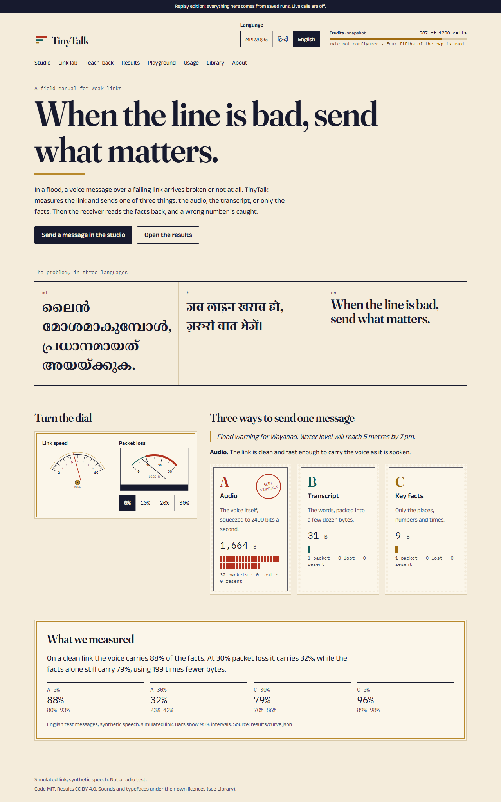
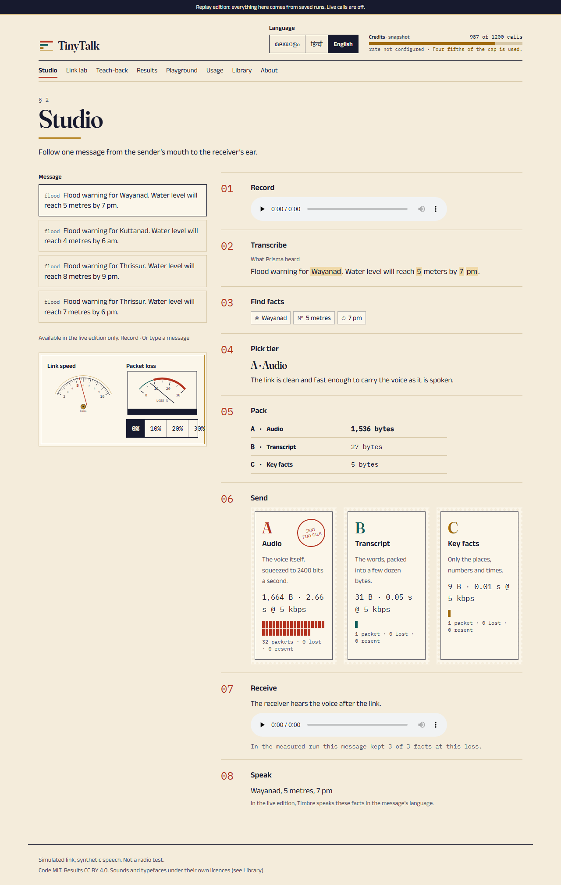
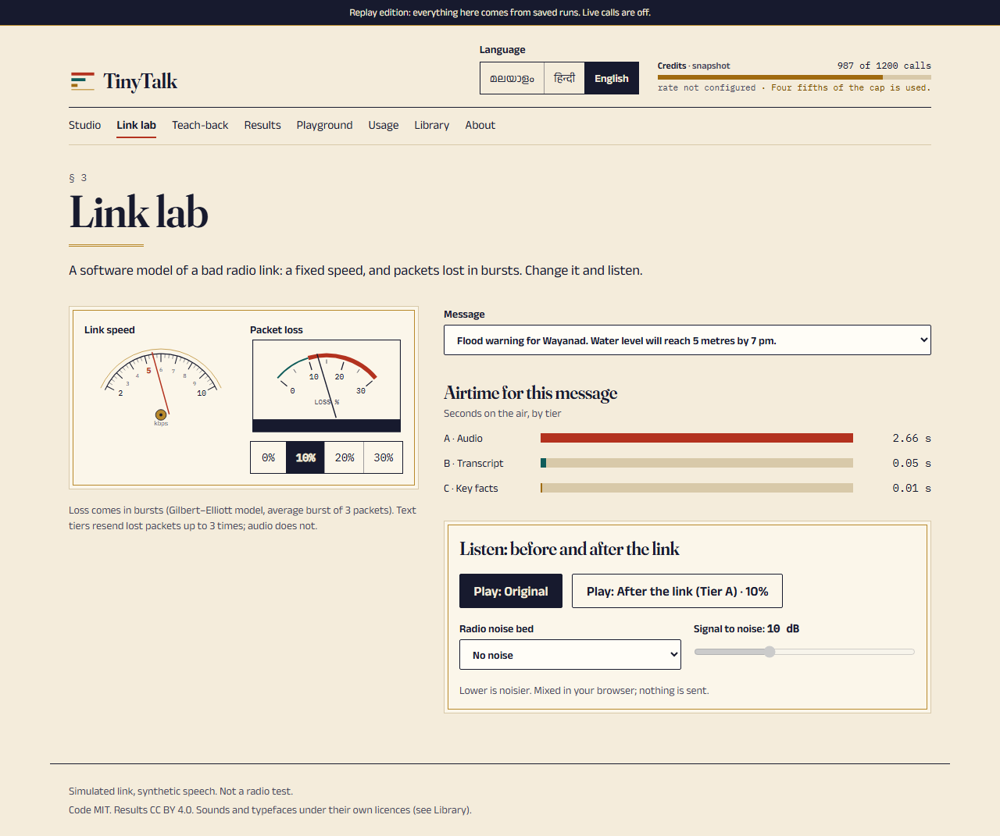
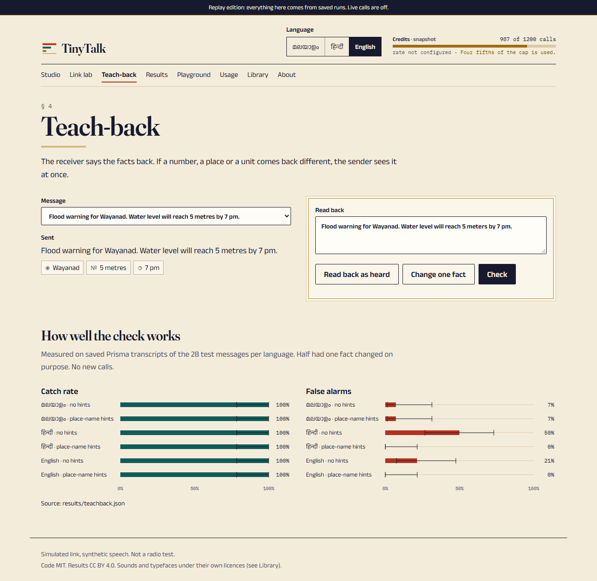
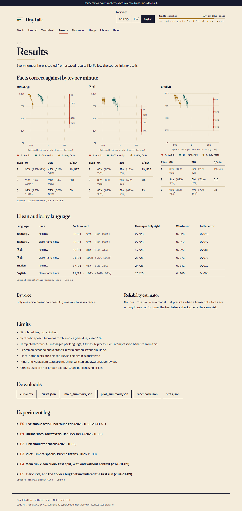
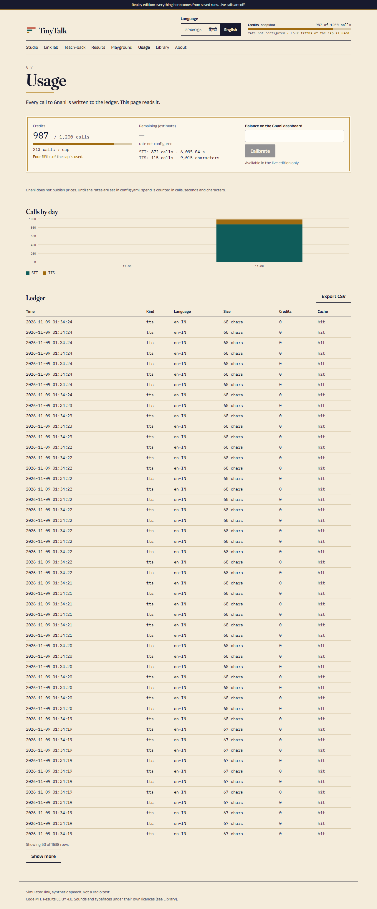
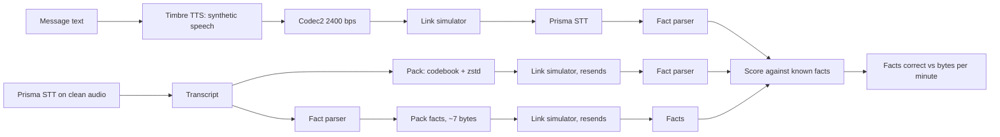
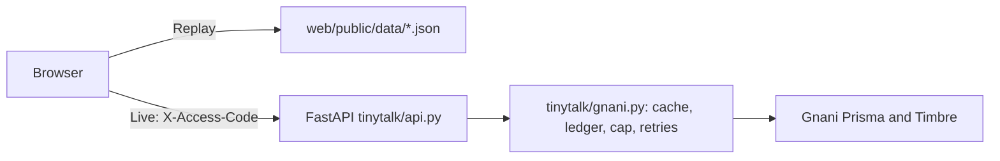

# TinyTalk

**Voice messages over weak links, by sending text instead of audio.**
Python 3.14 · FastAPI · Codec2 · zstd · Gnani Prisma (STT) + Timbre (TTS) · React 19 · TypeScript · Vite · Tailwind v4 · Motion · d3 · i18next (Malayalam, Hindi, English)

[](https://github.com/yaadhuu/Gnani_Hackathon/actions/workflows/ci.yml)

> **Status (9 Nov 2026):** all 11 build stages are done and pushed. Deadline Tue 10 Nov 2026, 23:59 IST. If you are picking this up, read [Handover](#handover-for-the-next-person) first.

## Contents

1. [The idea](#the-idea)
2. [Honest scope](#honest-scope)
3. [The web app](#the-web-app)
4. [Tech stack](#tech-stack)
5. [Architecture](#architecture)
6. [Results](#results)
7. [Quick start](#quick-start)
8. [Live mode and credits](#live-mode-and-credits)
9. [HTTP API](#http-api)
10. [Repository map](#repository-map)
11. [Tests and quality gates](#tests-and-quality-gates)
12. [Handover for the next person](#handover-for-the-next-person)
13. [Limits](#limits)
14. [How this was built](#how-this-was-built)
15. [License](#license)

## The idea

When a link is slow or lossy (think flood relief with a damaged network), a voice message may not get through. TinyTalk measures the link and picks what to send:

| Tier | What is sent | Size idea |
|------|--------------|-----------|
| A | Audio, compressed with Codec2 at 2400 bps (fallback: Opus 6 kbps) | about 300 bytes per second of speech |
| B | The full transcript, packed (place codebook, binary numbers, zstd dictionary) | tens of bytes |
| C | Only the critical facts: places, numbers with units, times | about 7 bytes |

A link meter chooses the tier from the link speed and the packet loss. At the receiver, a **teach-back** says the facts back in voice and the system checks that they match what was sent, so a wrong number is caught before anyone acts on it.

## Honest scope

- **Everything is simulated.** The link (2, 5 and 10 kbps; 0, 10, 20 and 30 percent packet loss, in bursts) is a software model (two-state Gilbert-Elliott, seeded). There was **no real radio test**, and none is claimed.
- All speech is synthetic (Gnani Timbre). No real people were recorded.
- The test corpus is templated (40 messages per language). It says nothing about free speech.
- Every number in this README comes from a saved output in `results/` and is logged in `docs/EXPERIMENTS.md`.

## The web app

Pick or type a message, set the simulated link, and TinyTalk shows which tier it would send, why, what it costs, and which facts arrive. Every packet is drawn, so you can see audio breaking up while the facts-only message is one packet.

Design: a "field manual / radio-room" look. Paper and ink colours, a tuning dial for link speed, a VU-style gauge for packet loss, perforated "stamp" cards for the three tiers, custom d3 charts. Works in Malayalam, Hindi and English, on screens from 360 to 1440 px, by keyboard, and with reduced motion.

| Home | Studio |
|---|---|
|  |  |
| **Link lab** | **Teach-back** |
|  |  |
| **Results** | **Usage and credit meter** |
|  |  |

| Page | What it does |
|---|---|
| Home | Headline, live dial demo, headline result |
| Studio | Pick, type or record a message; see tiers, bytes, packets, chosen tier |
| Link lab | Play with speed, loss and radio-noise beds (WebAudio SNR mix) |
| Teach-back | Alter one fact in the read-back and watch the check catch it |
| Results | The measured curves and tables, each linked to its source file |
| Playground | Live speech-to-text and text-to-speech (Live edition) or labelled saved samples (Replay) |
| Usage | Credit meter, ledger table, balance calibration |
| Library | The radio-noise beds, with licences |
| About | Method and limits |

### Two editions

| | Replay edition | Live edition |
|---|---|---|
| Data | Saved results exported to `web/public/data/` | Our FastAPI server, which calls Gnani |
| Server needed | No (static files, hash URLs, works offline) | Yes, `LIVE=1` and an access code |
| Credits | None | Spent, with a hard cap |
| Build | `npm run build:replay` | `npm run build:live` or `npm run dev:live` |

Both read through one `DataSource` interface (`web/src/data/source.ts`), so a page does not know which edition it runs in.

## Tech stack

**Backend and research code (Python 3.14, managed with `uv`)**

| Area | Tools |
|---|---|
| API server | FastAPI, uvicorn, python-multipart, httpx |
| Gnani access | `gnani-vachana` SDK reference, our own client in `tinytalk/gnani.py` (diskcache cache, tenacity retries, structlog ledger, call cap, replay mode) |
| Config and models | pydantic, pydantic-settings, PyYAML (`config.yaml` is the only settings file) |
| Audio | pycodec2 (Codec2 2400 bps on 8 kHz int16), soxr (resample), webrtcvad (trim silence), pydub and ffmpeg (decode uploads), optional pystoi |
| Link and coding | seeded Gilbert-Elliott loss model, CRC16 packets with up to 3 resends, zstandard with a dictionary trained on the dev split, reedsolo (FEC-versus-resend experiment only) |
| Text | `regex` with `\X` letter clusters (Malayalam), `unicodedata` NFC, indic-nlp-library, own number-word tables for Hindi and Malayalam, indic-transliteration (byte-cost test only), rapidfuzz (diagnostics only, never scoring) |
| Statistics and ML | numpy, pandas, scipy, statsmodels, scikit-learn (baselines), Wilson and bootstrap intervals, jiwer, matplotlib |
| Quality | ruff, mypy, pytest, hypothesis, respx, pre-commit (includes a secrets scan) |

**Gnani APIs** (header `X-API-Key-ID`)

- Prisma STT: `POST https://api.vachana.ai/stt/v3`, `prisma-v3.0`, 30 s max, `keyterms` up to 200.
- Timbre TTS: `POST https://api.vachana.ai/api/v1/tts/inference`, `timbre-v3.0`, 13 voices. One active request at a time (429 `RATE_LIMITED`), so calls are queued.
- Languages: bn-IN en-IN gu-IN hi-IN kn-IN ml-IN mr-IN pa-IN ta-IN te-IN. We evaluate ml-IN, hi-IN, en-IN.

**Web app (`web/`)**

| Area | Tools |
|---|---|
| Framework | React 19, TypeScript 7, Vite 8, react-router-dom 7 (hash router in Replay, browser router in Live) |
| Styling | Tailwind CSS v4, shadcn / Base UI primitives, class-variance-authority |
| Fonts | Fraunces, Rozha One, Noto Serif Malayalam, Tiro Devanagari Hindi, Anek (Latin, Devanagari, Malayalam), IBM Plex Mono |
| Data | @tanstack/react-query, d3-scale and d3-shape (custom SVG charts) |
| i18n | i18next and react-i18next, Hindi and Malayalam strings load only when chosen |
| Motion | `motion` (LazyMotion, `m`, `MotionConfig reducedMotion="user"`), 35,558 bytes gzipped, transform and opacity only |
| Tests | vitest, Testing Library, Playwright (two projects), Lighthouse CLI, oxlint |

CI: GitHub Actions (`.github/workflows/ci.yml`): Python checks and the web build and Playwright tests.

## Architecture





**Rule: only `tinytalk/gnani.py` talks to Gnani.** Every call passes through a disk cache, a ledger (`results/ledger.jsonl`), a call cap, retries and a replay mode that never calls the API. Do not add another path to Gnani.

## Results

Test split: 28 messages per language, one synthetic voice, simulated link at 5 kbps. Exact facts correct (places, numbers with units, times) with 95 percent Wilson intervals. Full numbers and the story of what went wrong are in `docs/EXPERIMENTS.md` (E3 to E5); raw files are in `results/`.

| Tier | Bytes on the air per minute of speech (0% loss) | English, 0% loss | English, 30% loss | Hindi, 0% / 30% | Malayalam, 0% / 30% |
|------|---:|---:|---:|---:|---:|
| A audio (Codec2) | about 19,506 | 0.879 (0.796-0.931) | 0.319 (0.232-0.420) | 0.681 / 0.253 | 0.978 / 0.407 |
| B transcript | 281 to 409 | 0.956 (0.892-0.983) | 0.802 (0.709-0.871) | 0.879 / 0.747 | 0.989 / 0.912 |
| C facts only | 80 to 98 | 0.956 (0.892-0.983) | 0.791 (0.697-0.862) | 0.879 / 0.879 | 0.989 / 0.791 |

Reading: on a clean link audio carries about as many facts as text but costs roughly 50 to 70 times the bytes of Tier B. Audio falls steeply as packets are lost; the text tiers lose only the messages that fail after three resends. Place-name hints (`keyterms`) took Prisma from 80/91 to 91/91 facts in Hindi and 87/91 to 91/91 in English on clean audio (E4; closed list of names, so optimistic).


**Teach-back (E6, measured on saved transcripts, no new calls).** Every deliberate one-fact change was caught: 14/14 in each language. False alarms follow Prisma's own errors: Hindi without place-name hints raised 7/14 false alarms; with hints, 0/14.

**Offline sizes** of packed messages (`results/sizes.json`, test split, average bytes per message; templated corpus, so Tier B looks better than free speech would):

| Language | Raw UTF-8 text | Tier B | Tier C |
|----------|---------------:|-------:|-------:|
| Malayalam | 226.3 | 25.8 | 6.6 |
| Hindi | 189.4 | 25.6 | 6.6 |
| English | 76.5 | 26.5 | 6.6 |

**A failure we kept.** The first Tier A run was invalid because the codec library processed only the first frame of each call. It cost 336 speech-to-text calls. It was caught, fixed with a frame-by-frame wrapper and a stronger test, and rerun. The failed data stays in `results/tiers_invalid_codec_bug.jsonl` (E5).

**Web quality (E7).** Playwright covers 10 pages at 360, 768 and 1280 px in three languages with no horizontal scroll and no clipped glyphs. Lighthouse accessibility is 98 to 100 everywhere. Lighthouse **performance is 97 to 98 on desktop but only 55 to 73 on throttled mobile, below the 90 target** (main-thread time and a chunk-then-JSON waterfall; the preview server also sends files uncompressed).

## Quick start

Needs Python (3.14 used; 3.10+ declared), [`uv`](https://docs.astral.sh/uv/), Node 20+, and `ffmpeg` on PATH only for Live uploads.

```bash
uv sync                                  # Python deps into .venv
make check                               # ruff, mypy, pytest (no network, no credits)
cd web && npm ci

# Replay edition: no key, no server, no credits
npm run build:replay && npx vite preview --port 4173      # http://localhost:4173

# Dev with the API in replay mode
uv run uvicorn tinytalk.api:app --port 8000               # terminal 1
cd web && npm run dev                                     # terminal 2, http://localhost:5173

make web-check                           # web build, vitest, Playwright (mocked API)
make reproduce                           # rebuild the curve from saved results (no credits)
make site-data                           # re-export results into web/public/data/ (needs local cache/)
```

On Windows, run these in Git Bash. `MinGW` and `cmake` are not on the default PATH; the `tools/codec2` build is only a fallback, because `pycodec2` is the primary codec path.

## Live mode and credits

Live mode makes real Gnani calls and spends credits. It is off by default.

```bash
cp .env.example .env            # then set GNANI_API_KEY (never commit .env)
export LIVE=1 ACCESS_CODE=<long random secret>
uv run uvicorn tinytalk.api:app --port 8000 --workers 1
cd web && npm run dev:live      # http://localhost:5173, proxies /api to :8000
```

Server-enforced protections (all in `config.yaml`, `credits:` and `live:`):

- `LIVE=1` **and** a matching `X-Access-Code` header (constant-time compare) are needed for any call that can spend credits.
- Per-IP limit (6 per minute), counted before the code check so guessing is slow.
- Global daily cap (`daily_call_cap: 100`) and a hard credit or call cap (`cap_calls: 1200` while rates are unknown).
- Warnings at 50, 80 and 95 percent of the cap; the server refuses calls at the cap. The app shows an estimate before each call, asks to confirm above `confirm_above`, then shows the actual spend.
- Uploads limited by type, 5 MB and 30 s. ffmpeg reads only piped input with a fixed format and a time limit; temp files are removed.
- Run one worker: the cap, the one-request lock and the rate limiter live in process memory.

**Credit rates are unknown.** Gnani publishes no prices and returns no usage field, so the meter counts calls and says "rate not configured". Set `credits_per_audio_second` and `credits_per_1k_chars` in `config.yaml` once known, and enter the dashboard balance on the Usage page. Spend history is in `docs/COSTS.md`. Total live attempts so far: 987, all HTTP 200; Stage 11 used none.

Stages that call Gnani are explicit:

```bash
uv run python -m scripts.run_stage pilot                       # dry run: counts missing calls
uv run python -m scripts.run_stage pilot --live --max-new-calls 70
```

Deployment details: `docs/DEPLOY.md`.

## HTTP API

| Endpoint | Purpose | Spends credits |
|---|---|---|
| `GET /api/health`, `/api/samples`, `/api/picker`, `/api/curve`, `/api/voices` | Read-only data | No |
| `GET /api/usage`, `POST /api/usage/calibrate` | Credit summary, ledger, set balance | No |
| `POST /api/estimate` | Cost estimate for a planned call | No |
| `POST /api/send` | Run the tiers on a message | Only in `LIVE=1` |
| `POST /api/teachback` | Check a read-back against sent facts | No |
| `POST /api/stt` | Prisma speech-to-text (multipart upload) | Yes |
| `POST /api/tts` | Timbre text-to-speech (base64 audio) | Yes |

## Repository map

```
tinytalk/            Python package
  gnani.py           the only Gnani client (cache, ledger, cap, retries, replay)
  api.py             FastAPI app, live guards, upload handling
  credits.py         ledger reader, estimates, warning levels
  linksim.py         bursty packet-loss link, resends
  codec.py           Codec2 / Opus wrappers (frame by frame)
  textpack.py        Tier B packing; facts.py Tier C and fact parser
  tiers.py, pipeline.py, evaluate.py   tiers and scoring
  teachback.py       read-back check; estimator.py tier picker
  corpus.py, lexicon.py                test messages, place and number tables
scripts/             run_stage, export_site_data, fetch/make radio beds, teachback_eval, contrast check
tests/               pytest and hypothesis tests (74)
web/                 React app: src/pages, src/components, src/data, src/locales, e2e/, public/data/
assets/              radio-noise beds + manifest (licences)
results/             saved outputs, ledger, curve, Lighthouse reports
data/corpus/         generated test messages
docs/                DIARY, DECISIONS, EXPERIMENTS, COSTS, VIVA, STORY, ASSETS, DEPLOY, BUILD_PLAYBOOK
config.yaml          every setting
CLAUDE.md            project rules and tool guide
```

## Tests and quality gates

| Check | Command | Last result |
|---|---|---|
| Python | `make check` | ruff, mypy clean; pytest 74 passed |
| Web unit | `cd web && npm test` | vitest 6 passed |
| Web e2e | `cd web && npx playwright test` | 19 passed (replay flows, reduced motion, screenshots, live edition against a fake server) |
| Web build | `cd web && npm run build:replay` | passes |
| Lighthouse | see `results/lighthouse/` | accessibility 98-100, desktop performance 97-98, mobile performance 55-73 |

Live API is never called by tests (httpx `MockTransport`, respx, and a fake server for Playwright).

## Handover for the next person

Read in this order: `CLAUDE.md` (rules), `docs/DIARY.md` (what happened and why, newest at the bottom), `docs/DECISIONS.md`, `docs/EXPERIMENTS.md` (every number), `docs/COSTS.md`.

**Rules that stay**

- Never commit or print the API key. It lives only in `.env`.
- Every Gnani call goes through `tinytalk/gnani.py`. Never add a second path.
- Never claim a real radio test. Report accuracy with intervals and show failures.
- Test speech is synthetic. Never record real people.
- Commits are authored by `yaadhuu` only. No co-author lines.
- Do not add a library without logging it in `docs/DECISIONS.md`.

**Open items (also in `docs/DIARY.md`, Open questions)**

1. **Strings review.** Malayalam and Hindi interface text is machine-written. Review `docs/review/ui_strings_review.md` (216 keys). Malayalam: Yadhu; Hindi: a native speaker.
2. **Radio beds.** 2 downloaded (public domain, CC BY 2.5) and 6 generated (CC0). Nobody has listened to the downloads. Decide whether CC BY-SA sounds are allowed (43 candidates were refused).
3. **Noise-condition speech-to-text** on the 96 mixed samples in `assets/channel/` is not run. It needs about 96 calls; approve first. Regenerate the files with `scripts/make_channel_samples.py`.
4. **Mobile Lighthouse performance is below 90.** Options: server compression, preloading route data, smaller Indic font subsets.
5. **Credit rates and balance** are unknown. See [Live mode and credits](#live-mode-and-credits).
6. **Live edition** was tested only against a fake server, never with real calls through the UI.
7. `docs/NORTH_STAR.md` is still a draft. Freeze time is not set. Rotate the API key after the hackathon.
8. A security review of one Stage 11 commit failed with HTTP 429 and was not rerun. The code-review plugin was not run on Stage 11.

**Known traps**

- `pycodec2` encodes and decodes only the first frame per call. Always use the wrapper in `tinytalk/codec.py` (test: `tests/test_codec_smoke.py`).
- The Codec2 decoder uses random phase, so decoded Tier A audio is cached. Without `cache/`, Tier A results cannot be reproduced exactly.
- Prisma limits clips to 30 s; Timbre allows one active request at a time (queue and back off on 429).
- Replay mode raises `ReplayMiss` for any call not in the cache. That is intended.
- `scripts/` is a package; run scripts as `python -m scripts.<name>`.
- About 5.8 MB of scratch screenshots sit in git history from one early Stage 11 commit (now untracked and ignored).

## Limits

- Simulated link only; no radio test.
- The corpus is 40 templated messages per language (12 places, 4 message types).
- Malayalam and Hindi sentences and interface text are machine-written; native-speaker review is pending.
- Number words: English, Hindi (1 to 99) and Malayalam (1 to 20 and tens). Prisma normally returns digits, so this is a fallback.
- Tier A recognition uses Prisma on the decoded audio as a stand-in for a human listener.
- Only one voice (Vasudha) and one speed (1.0) were run for the main results. Prisma v2.5, `transliterate` and the other voices were not run (credit limit).
- Teach-back was measured with a text stand-in for the spoken read-back, 14 messages per group, so the intervals are wide.
- In Replay the app shows Tier A's size and packets but cannot read its facts (that needs live Prisma).
- Credits are UNVERIFIED until read from the Gnani dashboard.
- Mobile Lighthouse performance misses the 90 target.
- Not built: a reliability estimator beyond the rule baseline, real-radio validation.

## How this was built

Claude Code assisted with the code under Yadhu's direction. Engineering control came from a diary (`docs/DIARY.md`), a decision record (`docs/DECISIONS.md`), an experiment log with numbers copied from real outputs (`docs/EXPERIMENTS.md`), tests on the pure logic, and a call cap on every paid API.

## License

MIT, see `LICENSE`. Radio-noise bed licences are in `docs/ASSETS.md` (one bed is CC BY 2.5 and needs attribution).
