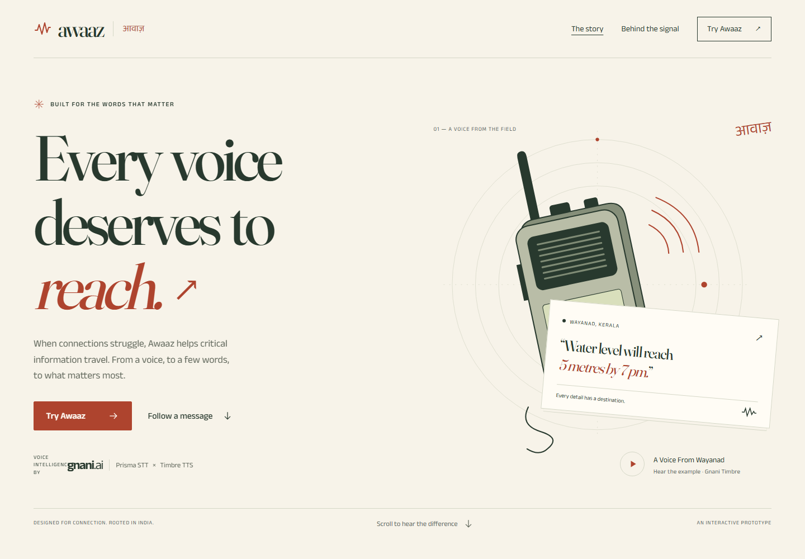
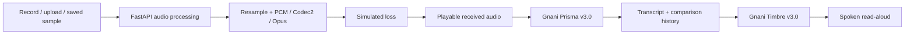

<div align="center">

# Awaaz

### Every voice deserves to reach.

**Voice intelligence for the moments a connection cannot afford to lose.**

Built for the Gnani hackathon · Powered by **Prisma v3.0** and **Timbre v3.0**

[Live website](https://awaaz-gnani.vercel.app) · [Explore the project](#the-experience) · [Run locally](#run-locally) · [Deployment](#deployment) · [Evidence](#evidence-and-validation)


</div>



## Why Awaaz

A medical team needs the right location. A station controller needs the right instruction. A field worker needs help to arrive before a deadline. When speech breaks up, losing a number or a place can change the entire message.

Awaaz explores how to preserve critical information across weak connections: carry voice when possible, a compact transcript when appropriate, and recognised facts when a smaller message is needed. Its interactive workspace makes the problem tangible: **record your own speech, degrade the actual audio, and see what Gnani Prisma hears.**

This is a working experimental prototype. Network loss is simulated; real-radio deployment and operational safety have not been validated.

## The experience

| Experience | What you can do |
| --- | --- |
| **The story** | Follow a message through scroll-linked signal and text transformations, with medical, supply and rescue examples. |
| **Voice workspace — `/try`** | Record or upload speech, change real audio settings, play/download the received waveform, transcribe it, and hear a Timbre read-aloud. |
| **Behind the signal — `/inspect`** | Inspect saved experiments, accuracy curves, source files, assumptions and failure cases. |
| **Method — `/how`** | Understand the three-tier approach, teach-back and current limitations. |

The interface combines expressive editorial typography, Indian-language details, original radio artwork, Lenis smooth scrolling and Motion animations. Keyboard controls, reduced-motion preferences and narrow layouts are supported.

### Try it in a minute

1. Open **Try Awaaz** and choose a sample, record a message, or upload audio.
2. Listen to the original. Switch from PCM to Codec2 or Opus and adjust simulated loss.
3. Listen to the received audio. The codec changes the waveform before recognition.
4. Select a language or automatic detection, then click **Transcribe received audio**.
5. Compare results across settings and use **Read aloud with Timbre** to hear the transcript.

Recordings/uploads support **up to 30 seconds and 4 MB**. Recording is live microphone capture followed by transcription after stopping; streaming partial captions are not implemented.

## Gnani at the centre

| Capability | Integration |
| --- | --- |
| **Prisma v3.0 STT** | Transcribes the decoded received waveform, including the selected degradation. |
| **Ten speech languages** | Bengali, English, Gujarati, Hindi, Kannada, Malayalam, Marathi, Punjabi, Tamil and Telugu. |
| **Automatic language detection** | Lets visitors speak without selecting a language first. |
| **Four output modes** | Clean transcript, verbatim, code-mix and transliteration. No translation is claimed. |
| **Keyterm prompting** | Optional place names, terminology and call signs help recognition without retraining the model. |
| **Timbre v3.0 TTS** | Reads a transcript aloud with an explicit language choice when needed. |
| **Controlled model access** | All calls use the existing server-side Gnani client, ledger, retries and global caps. |

Detailed integration notes: [Gnani feature coverage](docs/GNANI_USE.md).

## Real audio processing

| Mode | Adjustable settings | What actually happens |
| --- | --- | --- |
| **PCM** | 8/16-bit; 8, 16, 24 or 48 kHz | Resampling, quantisation and simulated packet erasure. |
| **Codec2** | Fixed 8 kHz / 2.4 kbps; loss control | Real frame-by-frame Codec2 encoding/decoding; lost chunks become silence. |
| **Opus** | 6, 12, 24 or 48 kbps; sample rate; loss control | Real Opus encoding/decoding, followed by explicitly labelled simulated 20 ms frame erasures. |

Opus loss emulation is **not** native Opus packet-loss concealment. Encoded payload size and preview WAV size are separate. Changing settings invalidates the current transcript, while labelled history retains earlier results.

Different waveforms can legitimately produce the same correct words. Awaaz never edits a transcript merely to manufacture a difference, and never substitutes an unrelated saved example for failed live recognition.

## Architecture



The accompanying research compares compressed audio, packed transcripts and binary fact payloads. A teach-back comparison checks whether recognised places, quantities and times match. Its closed-list fact extraction and measured benchmark cover English, Hindi and Malayalam; **ten-language speech-service support does not imply ten-language fact-extraction accuracy**.

## Evidence and validation

Before the final submission handoff, the following checks passed:

- **91 Python tests**; strict mypy across **50 source files**; Ruff.
- **618 frontend unit tests**; production Replay build.
- **37 browser regression tests**, including microphone capture with Chromium's synthetic microphone, real backend codec processing, upload, mobile layouts, failure handling and scroll-linked transformations.
- A final **four-test workspace rerun** also covered the read-aloud language control.

**Actual model demonstration:** a 22.5-second public synthetic dispatch was sent to Prisma twice. Clear PCM retained the medical, supply and rescue details. Codec2 with 40% simulated loss returned a materially different transcript with missing/confused information. One Timbre request returned 5.6 seconds of spoken output. These are demonstrations, not a new accuracy benchmark.

| Evidence | Location |
| --- | --- |
| Live Prisma settings, waveform hashes and responses | [workspace-live-smoke.json](results/workspace-live-smoke.json) |
| Live Timbre verification metadata | [workspace-tts-smoke.json](results/workspace-tts-smoke.json) |
| Original experiments and methodology | [EXPERIMENTS.md](docs/EXPERIMENTS.md) |
| Current workspace QA and limitations | [AWAAZ_VOICE_QA.md](docs/AWAAZ_VOICE_QA.md) |
| Frontend design review | [AWAAZ_FRONTEND_QA.md](docs/AWAAZ_FRONTEND_QA.md) |
| API usage and integration matrix | [GNANI_USE.md](docs/GNANI_USE.md) |

The original benchmark uses templated synthetic speech and seeded burst-loss simulation. Results do not establish performance on unrestricted emergency speech, physical radios or real operational deployments. Physical-phone and screen-reader validation remain outstanding.

## Privacy and credit protection

- The Gnani key remains on the server; it is never included in browser code.
- Visitor audio and transcripts use bounded, expiring server memory and bypass persistent model-result caching.
- **Four live model requests per signed visitor cookie per UTC day**; STT and TTS each consume an attempt. Repeated identical results can be reused without another model call.
- Audio previews do not spend model credits. Server-wide caps and per-IP request limits also apply.
- Anonymous limits are not proof of unique human identity. Failed model attempts still count.

Visitor clips stay in expiring server memory. A signed preview receipt lets another Vercel instance recover the processed waveform from the browser without persisting speech. Production requires a stable session-signing secret and shared Redis usage counters.

## Run locally

Requirements: Python with `uv`, Node.js 20+, and FFmpeg with Opus support. Codec2 is provided through `pycodec2`.

```bash
git clone https://github.com/yaadhuu/Awaaz.git
cd Awaaz
uv sync
cd web
npm ci
npm run build:replay
npm run preview -- --port 4173
```

In another terminal, start the backend from the repository root:

```bash
uv run uvicorn tinytalk.api:app --port 8000 --workers 1
```

Open **[localhost:4173](http://localhost:4173)**. The preview proxies `/api` to port 8000. Saved story examples need no key; the audio workspace needs the backend for processing.

To enable live Prisma/Timbre calls, put `GNANI_API_KEY` in an ignored `.env` file and set these variables **in the backend process environment**:

```dotenv
LIVE=1
AWAAZ_PUBLIC_LIVE=1
AWAAZ_SESSION_SECRET=<a-long-random-private-secret>
```

Use your shell or hosting dashboard to set them before starting the server. Legacy research endpoints additionally use `ACCESS_CODE`. Do not place any secrets in `VITE_*` variables. Microphone capture requires HTTPS or localhost.

## Deployment

The repository includes Vercel frontend/API service configuration. Import the repository with root directory **`.`**. See **[DEPLOY.md](docs/DEPLOY.md)** for routing and runtime requirements.

The Vercel API bundles FFmpeg, keeps writable runtime files under `/tmp`, and uses Upstash Redis for atomic visitor/IP/global limits and a cross-instance model mutex. Set `AWAAZ_SESSION_SECRET`, `GNANI_API_KEY`, Redis REST credentials, `LIVE=1` and `AWAAZ_PUBLIC_LIVE=1` in production. Without the shared quota configuration, public live speech stays disabled. Redis stores counters and a bounded lock, never visitor speech or transcripts.

For a static showcase, build `web/` with `npm run build:replay` and publish `web/dist`. The story and saved audio remain available; live processing requires a reachable backend. The website is deployed at **https://awaaz-gnani.vercel.app**. Live-model availability is shown in the workspace and depends on the production environment configuration.

## Technology

**Frontend:** React 19 · TypeScript · Vite · Tailwind CSS · Motion · Lenis · TanStack Query · d3 · i18next  
**Backend:** Python · FastAPI · Gnani Prisma/Timbre · NumPy · soxr · Codec2 · FFmpeg/Opus · zstandard · SQLite  
**Quality:** pytest · Vitest · Playwright · Ruff · mypy

The historical Python package and research fixtures retain the name `tinytalk`.

## Author and acknowledgements

Built by **[Yadhu / @yaadhuu](https://github.com/yaadhuu)** for the Gnani hackathon, with AI coding assistance.

Speech intelligence is powered by Gnani. Third-party radio recordings are separately credited, including CC0 amateur-radio audio and public-domain NASA mission audio. They are listening references, not endorsements or evidence of Awaaz working on real radios. See [audio sources and licences](docs/ASSETS.md).

## License

[MIT](LICENSE). Third-party assets retain their stated licences.
