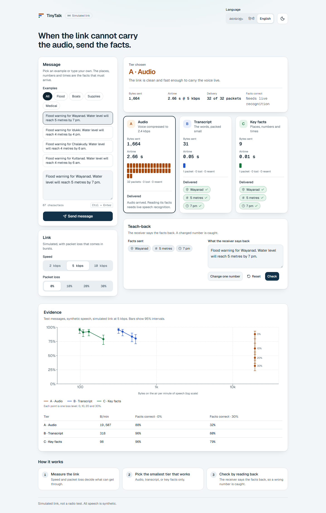
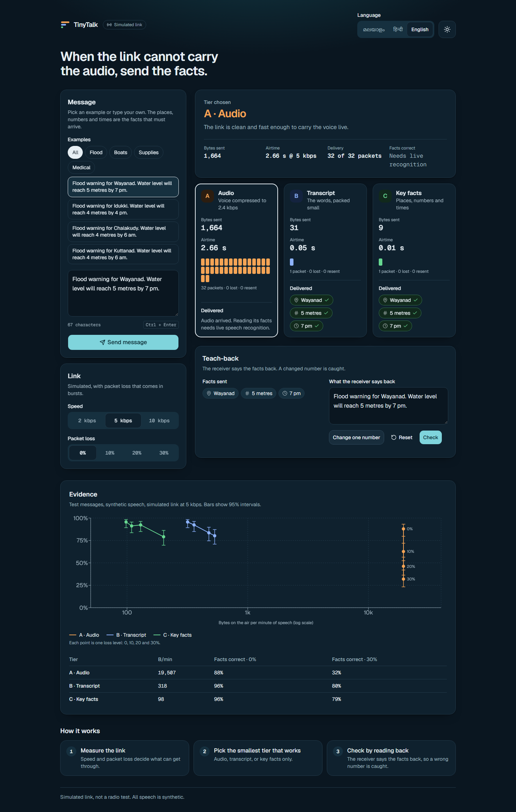
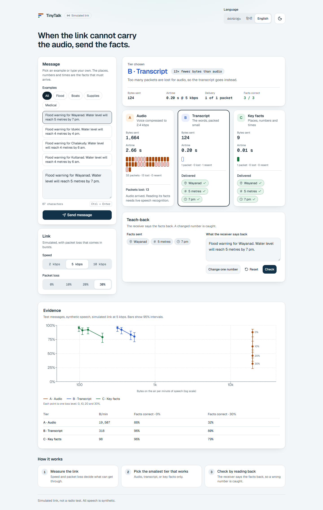
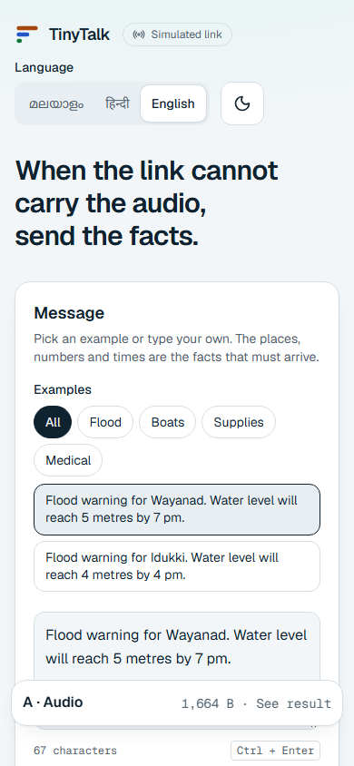
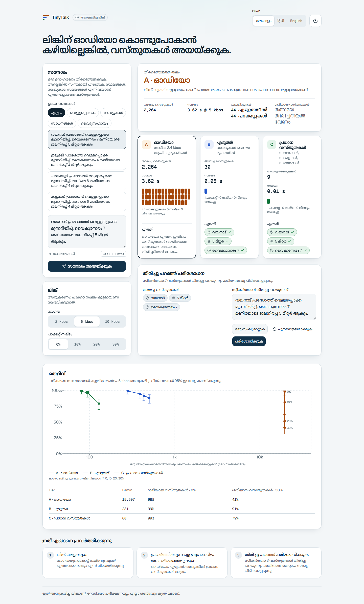
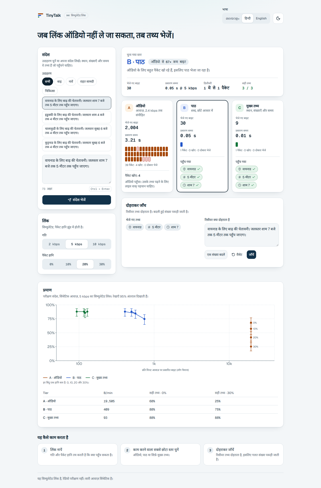
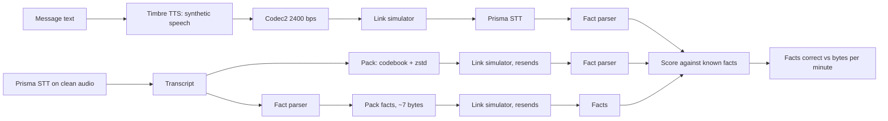
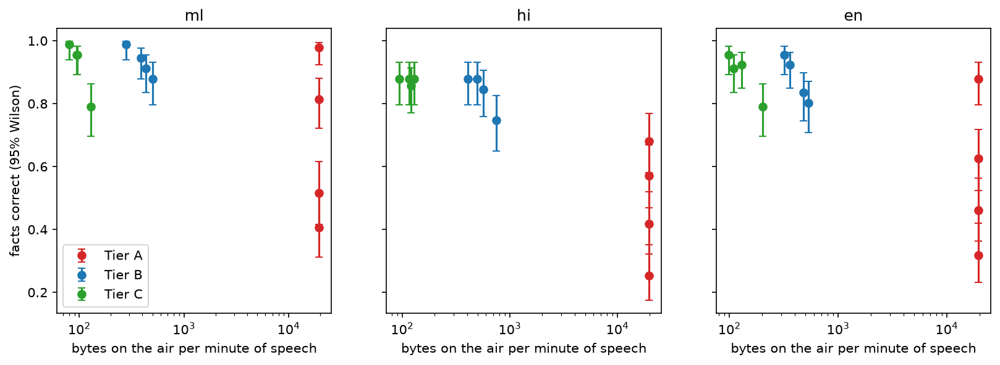

# TinyTalk

[](https://github.com/yaadhuu/Gnani_Hackathon/actions/workflows/ci.yml)

Voice messages over weak links, by sending text instead of audio.

When a link is slow or lossy (think flood relief with a damaged network), a voice message may not get through. TinyTalk measures the link and picks what to send:

| Tier | What is sent | Size idea |
|------|--------------|-----------|
| A | Audio, compressed with Codec2 at 2400 bps (fallback: Opus 6 kbps) | 300 bytes per second of speech |
| B | The full transcript, packed (place codebook, binary numbers, zstd dictionary) | tens of bytes |
| C | Only the critical facts: places, numbers with units, times | about 7 bytes |

At the receiver, a voice teach-back says the facts back and the system checks that they match.

**Everything here is simulated.** The link (2, 5 and 10 kbps; 0, 10, 20 and 30 percent packet loss, in bursts) is a software model. There was no real radio test. All speech is synthetic (Gnani Timbre). No real people were recorded.

## The app

Pick or type a message, set the simulated link (speed and packet loss), and TinyTalk shows which tier it would send, why, what it costs, and which facts arrive. Every packet is drawn, so you can see audio breaking up while the facts-only message is one packet. A teach-back panel lets you change one number in the receiver's read-back and watch it get caught. An evidence section shows the measured curve. Works in Malayalam, Hindi and English, light and dark, on phones and desktops, and by keyboard.

| Light | Dark |
|---|---|
|  |  |
|  |  |
|  |  |

## Architecture



Only `tinytalk/gnani.py` talks to Gnani. Every call goes through a disk cache, a ledger (`results/ledger.jsonl`), a call cap, retries and a replay mode that never calls the API.

## Results

Test split: 28 messages per language, one synthetic voice, simulated link at 5 kbps. Exact facts correct (places, numbers with units, times) with 95 percent Wilson intervals. Full numbers and the story of what went wrong are in `docs/EXPERIMENTS.md` (E3 to E5); raw files are in `results/`.

| Tier | Bytes on the air per minute of speech (0% loss) | English, 0% loss | English, 30% loss | Hindi, 0% / 30% | Malayalam, 0% / 30% |
|------|---:|---:|---:|---:|---:|
| A audio (Codec2) | about 19,506 | 0.879 (0.796-0.931) | 0.319 (0.232-0.420) | 0.681 / 0.253 | 0.978 / 0.407 |
| B transcript | 281 to 409 | 0.956 (0.892-0.983) | 0.802 (0.709-0.871) | 0.879 / 0.747 | 0.989 / 0.912 |
| C facts only | 80 to 98 | 0.956 (0.892-0.983) | 0.791 (0.697-0.862) | 0.879 / 0.879 | 0.989 / 0.791 |

Reading: on a clean link audio carries about as many facts as text but costs roughly 50 to 70 times the bytes of Tier B. Audio falls steeply as packets are lost; the text tiers lose only the messages that fail after three resends. Place-name hints (`keyterms`) took Prisma from 80/91 to 91/91 facts in Hindi and 87/91 to 91/91 in English on clean audio (E4, closed list of names, so optimistic).

The curve (`results/curve.png`):



A first Tier A run was invalid because of a codec library bug (it processed only the first frame). It was caught, fixed, tested and rerun; the failed data is kept in `results/tiers_invalid_codec_bug.jsonl` (E5).

Offline sizes of packed messages (`results/sizes.json`, test split, average bytes per message; the corpus is templated, so Tier B looks better than it would on free speech):

| Language | Raw UTF-8 text | Tier B | Tier C |
|----------|---------------:|-------:|-------:|
| Malayalam | 226.3 | 25.8 | 6.6 |
| Hindi | 189.4 | 25.6 | 6.6 |
| English | 76.5 | 26.5 | 6.6 |

## Run it

```
uv sync
make check          # ruff, mypy, pytest (no network, no credits)
make demo           # prints the two commands that start the API and the web app (http://localhost:5173)
make web-check      # web build, component tests and Playwright end-to-end tests (mocked API)
make reproduce      # rebuilds the curve from saved results (no credits)
```

Live stages need `GNANI_API_KEY` in `.env` (see `.env.example`) and spend credits, so they are explicit:

```
uv run python -m scripts.run_stage pilot                       # dry run: counts missing calls
uv run python -m scripts.run_stage pilot --live --max-new-calls 70
```

The API runs in replay mode by default. `LIVE=1` allows real Gnani calls and then requires `TINYTALK_TOKEN` in the `X-Tinytalk-Token` header.

## Limits

- Simulated link only; no radio test.
- The corpus is 40 templated messages per language (12 places, 4 message types). It says nothing about free speech.
- Malayalam and Hindi sentences are machine-written; a native-speaker review is pending (`docs/review/`).
- Number words are covered for English, Hindi (1 to 99) and Malayalam (1 to 20 and tens). Prisma normally returns digits, so this is a fallback.
- The Codec2 decoder adds random phase, so decoded audio differs between runs. Tier A results are reproducible only from the stored decoded audio in the cache.
- Tier A recognition uses Prisma on the decoded audio as a stand-in for a human listener.
- Credits used and remaining are in `docs/COSTS.md`. Gnani publishes no prices, so credits are UNVERIFIED until read from the dashboard.
- Only one voice (Vasudha) and one speed (1.0) were run. Prisma v2.5, `transliterate` and the other voices were not run (credit limit).
- The app's Hindi and Malayalam interface text is machine-written and unreviewed. In replay mode the app shows Tier A's size and packets but cannot read its facts (that needs live Prisma).
- Not built: voice recording in the web UI, measured voice teach-back rates, the reliability estimator.

## How this was built

Claude Code assisted with the code under Yadhu's direction. Engineering control was kept with a diary (`docs/DIARY.md`), a decision record (`docs/DECISIONS.md`), an experiment log with numbers copied from real outputs (`docs/EXPERIMENTS.md`), tests on the pure logic, and a call cap on every paid API.

## License

MIT, see `LICENSE`.
